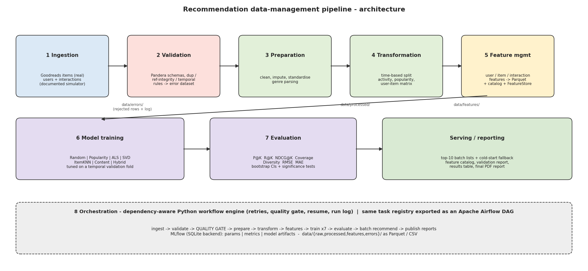
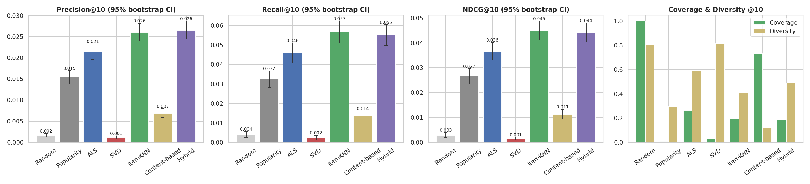
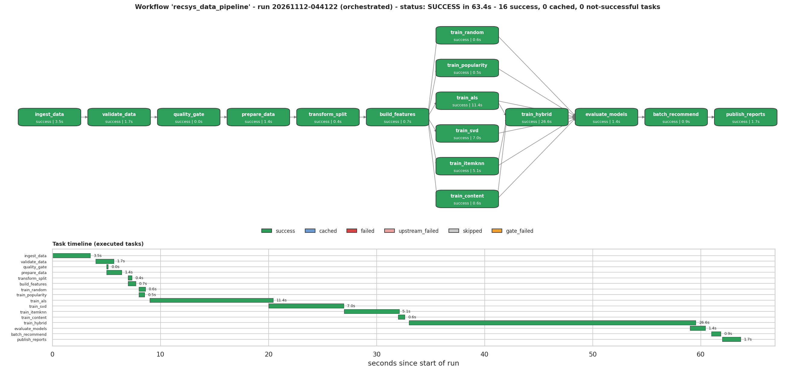

# Name: Karthik S Rajan
# Roll No.: 2025AG05779

# End-to-End Data Management Pipeline for a Book Recommendation System

Data Management for Machine Learning - Assignment 2. A modular, reproducible pipeline:
**ingestion -> validation -> preparation -> transformation -> feature management -> model training -> evaluation -> orchestration**,
plus a serving layer (top-K with cold-start fallback) and an auto-generated final report. Runs in a Kaggle / Jupyter notebook or from the command line - **no cloud account required**.



## Data
* **source** - https://www.kaggle.com/datasets/khanhdnguyen/goodreadss-books/data (file: `Goodreadss Books.csv`)
* **items** - real Goodreads books metadata (20,068 rows; CSV not redistributed here - download it from the link above and pass its path with `--source-csv`).
* **users / interactions** - *synthetic, documented* (see `src/ingestion/ingest.py`): ratings are drawn from each book's real 1-5 star histogram; ~2 % faults are injected to exercise validation.
  Model scores therefore describe the simulator, not real Goodreads behaviour.

## Quick start
```bash
pip install -r requirements.txt
python -m src.pipeline.run --base . --source-csv "/path/to/Goodreadss Books.csv"          # full pipeline (~1 min on CPU)
python -m src.pipeline.run --base . --resume                                           # idempotent re-run (cached tasks are skipped)
python -m src.pipeline.run --base . --dry-run                                          # show the task graph
mlflow ui --backend-store-uri sqlite:///mlflow.db                                      # browse tracked experiments
```
Scheduling (cron, nightly): `0 2 * * * cd /path/to/project && python -m src.pipeline.run --base . --resume`  
Airflow: copy the project next to Airflow and place `dags/recommendation_pipeline_dag.py` in `$AIRFLOW_HOME/dags/` (it reuses the same task registry).

## Project structure
```
data/{raw,processed,features,errors}/    src/{ingestion,validation,preparation,transformation,features,training,evaluation,serving,reporting,pipeline}/
dags/recommendation_pipeline_dag.py      configs/pipeline_config.json      models/      reports/      mlflow.db + mlruns/
```

## Pipeline stages and key decisions
| Stage | Module | Decision |
|---|---|---|
| Ingestion | `src/ingestion` | raw extracts stored untouched; documented simulator + fault injection with ledger |
| Validation | `src/validation` | Pandera + custom rules, severity reject/warning, referential integrity, error dataset, HTML report |
| Preparation | `src/preparation` | category-median imputation with `*_imputed` flags; genre boilerplate removal |
| Transformation | `src/transformation` | leak-free time split (asserted), temporal validation fold, activity / popularity / sparse matrix |
| Features | `src/features` | train-only features at fixed REF_DATE, Parquet, catalog, `FeatureStore` shared by training and prediction |
| Training | `src/training` | 7 models, tuning on validation fold, MLflow tracking (nested trials) |
| Evaluation | `src/evaluation` | P/R/NDCG@5,10, Coverage, Diversity, RMSE, MAE, bootstrap CIs, paired significance tests |
| Serving | `src/serving` | best model + popularity fallback for cold-start users |
| Orchestration | `src/pipeline`, `dags/` | dependency-aware engine (retries, quality gate, resume) + Airflow DAG from the same registry |

## Results (test window, K = 5 / 10)
| Model                            |   Precision@5 |   Recall@5 |   NDCG@5 |   Precision@10 |   Recall@10 |   NDCG@10 |   Coverage@10 |   Diversity@10 | RMSE   | MAE    |
|:---------------------------------|--------------:|-----------:|---------:|---------------:|------------:|----------:|--------------:|---------------:|:-------|:-------|
| Random (sanity floor)            |        0.0016 |     0.002  |   0.002  |         0.0017 |      0.004  |    0.0028 |        1      |         0.8009 | -      | -      |
| Popularity (baseline)            |        0.0197 |     0.0201 |   0.0242 |         0.0154 |      0.0324 |    0.0266 |        0.008  |         0.296  | 0.9336 | 0.754  |
| ALS (implicit MF)                |        0.0242 |     0.0248 |   0.0307 |         0.0214 |      0.0458 |    0.0365 |        0.2644 |         0.5886 | -      | -      |
| SVD (Surprise MF)                |        0.0008 |     0.001  |   0.0009 |         0.0011 |      0.0024 |    0.0015 |        0.0263 |         0.815  | 0.9317 | 0.7316 |
| ItemKNN (cosine CF)              |        0.0295 |     0.03   |   0.0377 |         0.026  |      0.0567 |    0.0449 |        0.1907 |         0.405  | -      | -      |
| Content-based (genres)           |        0.0086 |     0.0091 |   0.0102 |         0.0069 |      0.0135 |    0.0112 |        0.7312 |         0.1168 | -      | -      |
| Hybrid (ItemKNN + ALS + content) |        0.0303 |     0.0322 |   0.0377 |         0.0265 |      0.055  |    0.0442 |        0.1871 |         0.4888 | -      | -      |





## Reproducibility
Fixed seeds, one config file (`configs/pipeline_config.json`, fingerprint `8726e8b0e8a8`), pinned `requirements.txt`; the orchestrated run reproduces the stage-by-stage results exactly
(full run: 63.4 s, 16 tasks). See `reports/final_report.pdf` for the design report.

## Deliverable map
`reports/architecture_diagram.png` - architecture | `reports/data_validation_report.html`, `data/errors/` - validation | `reports/feature_catalog.csv|md` - features |
`reports/model_results.csv` (+ `_ci`, `significance_tests`) - evaluation | `reports/orchestration_run.png` - successful run | `reports/final_report.pdf` - report
